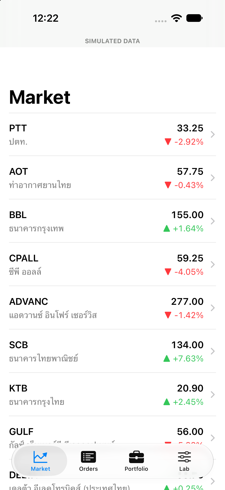
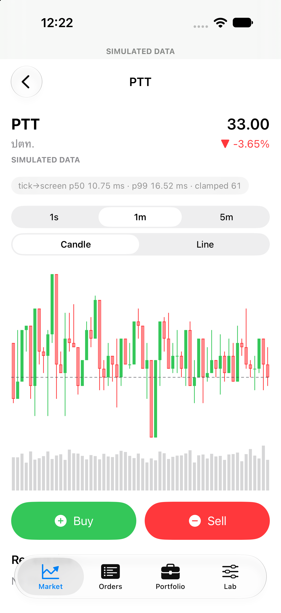
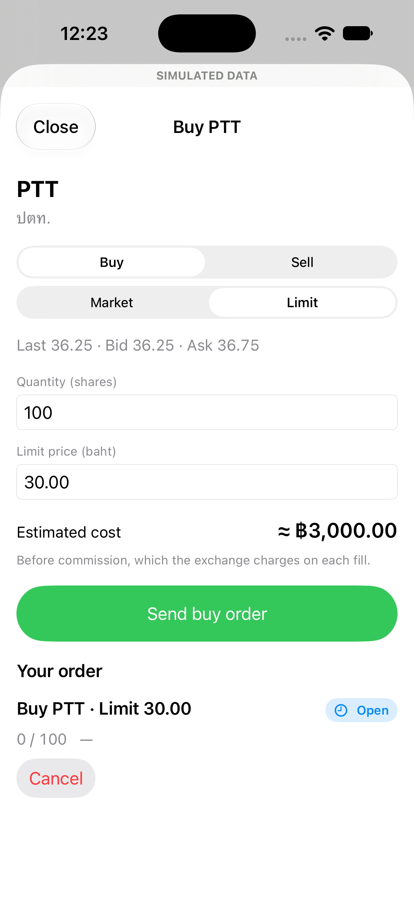
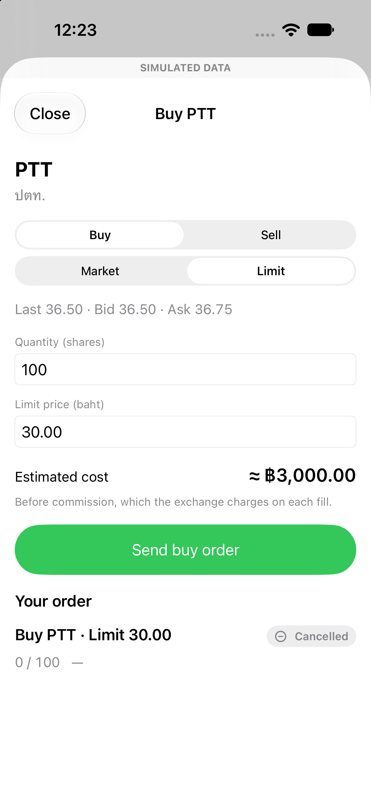
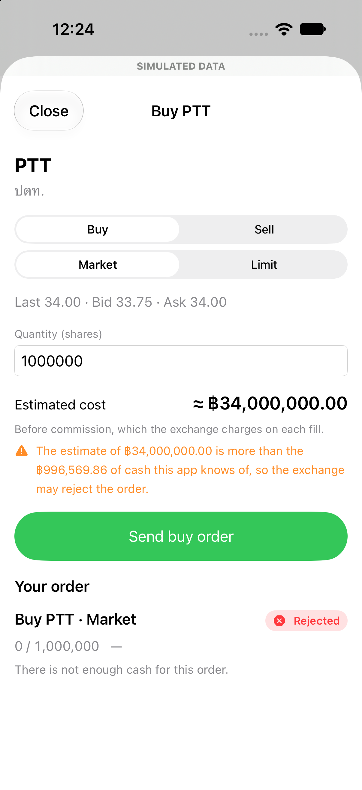
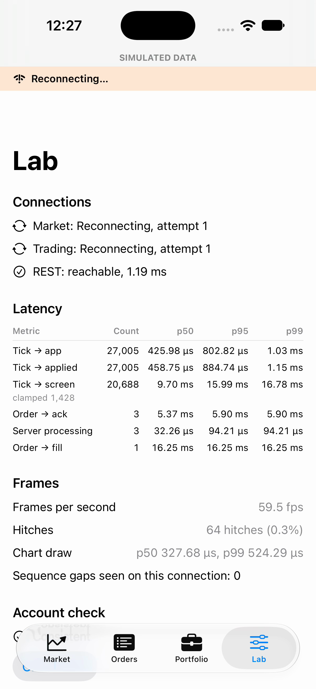
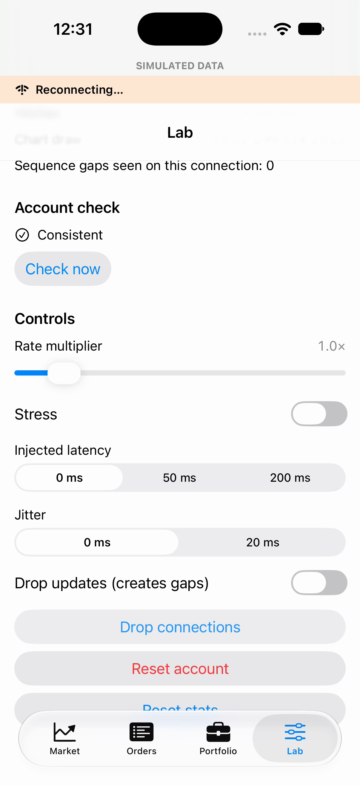
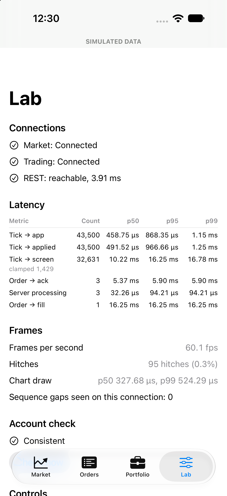
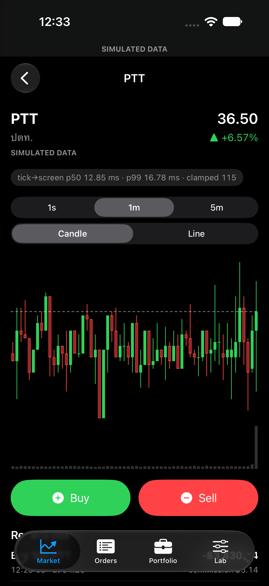
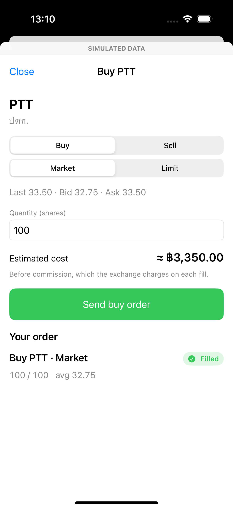

# TradePulse

**SIMULATED DATA.** TradePulse is a proof-of-concept investment app for iPhone, together with the mock exchange it talks
to. There is no real market data, no real money and no broker in it: every price, account and order is invented by the
exchange server in `Server/`, and every screen of the app carries a "SIMULATED DATA" strip.

It shows three things on real protocols: live market data (a watchlist and a live candle chart), order entry and the
whole life of an order (market and limit orders, fills, cancels, rejections, portfolio and transactions), and the speed
of both, which the app measures and prints itself. Everything runs on one Mac: the exchange is a Swift program and the
app runs in the iOS Simulator.

- [What the demo shows](#what-the-demo-shows)
- [Architecture](#architecture)
- [Run it](#run-it)
- [Measured](#measured)
- [Screenshots](#screenshots)
- [Minimum OS](#minimum-os)
- [Known limitations](#known-limitations)
- [Not in this version](#not-in-this-version)
- [Repository layout](#repository-layout)
- [Documents](#documents)

## What the demo shows

The two-minute demo walks these steps on the simulator, against the real server. Each step has a screenshot below.

| Step | What you see | What carries it |
| --- | --- | --- |
| 1 | Market tab: the watchlist of 12 symbols, prices moving | REST for the list of symbols, WebSocket for the prices |
| 2 | A symbol opens: the candle chart moves live, and a latency chip shows tick to screen p50 and p99 | REST for the chart's history, WebSocket for the live candle |
| 3 | Buy at market: the order is accepted and filled; Portfolio shows the cash, the position and the transaction | gRPC `SubmitOrder` and the order event stream; REST for the account and the transactions |
| 4 | A limit buy below the market stays open; Cancel ends it Cancelled | gRPC `SubmitOrder`, `CancelOrder`, event stream |
| 5 | A wrong order is refused with its reason: a price off the tick or a quantity that is not a multiple of 100 never leaves the ticket; more than the cash is rejected by the exchange | the ticket's own checks; the exchange's answer over gRPC |
| 6 | Lab, Drop connections: a "Reconnecting..." banner, then the connections are back and the app's account agrees with the server's | WebSocket and gRPC reconnect, REST for the account check and the lab |
| 7 | Lab, Stress: the server generates 6,000 ticks a second and the live latency numbers keep counting (in the recorded Release run the p99 was 15.73 ms, with 0 hitches in 1,787 frames) | REST for the lab's settings |

Which protocol carries what:

| Protocol | Used for |
| --- | --- |
| REST (JSON over HTTP, port 18080) | symbols (with an ETag), candles, the account, transactions, the server's clock, a health check and the lab's admin calls (`/v1/*`, `/healthz`) |
| WebSocket `/ws/market` (port 18080) | the market feed: the app subscribes to symbols and the server sends binary Protobuf frames, each with the newest state of every symbol that changed; JSON text messages control the feed (subscribe, unsubscribe, ping, resync) |
| gRPC `OrderService` (HTTP/2, Protobuf, port 18051) | `SubmitOrder` (carries a client-chosen `client_order_id`, so a repeat is the same order), `CancelOrder`, and `StreamOrderEvents`, a stream of accepted, rejected, fill, cancelled and ledger events that can be resumed from a sequence number |

All of it is cleartext on loopback; there is no TLS in this version.

## Architecture

```
 iOS app (in the Simulator)                                 Exchange server (Swift, on the same Mac)
+----------------------------------------------+           +----------------------------------------------+
| SwiftUI: Market, Chart, Order ticket,        |           | SimulatedMarket --> MarketHub (conflates     |
|          Orders, Portfolio, Lab              | WebSocket |   the ticks of each connection into frames)  |
|                                              |<--------->| WebSocket  /ws/market   Protobuf frames      |
| MarketDataClient --> MarketState             |           |                                              |
|   (latest wins) --> display link --> Canvas  |   REST    | REST       /v1/*, /healthz   JSON            |
|                                              |<--------->|                                              |
| RestClient (URLSession)                      |           | gRPC       OrderService (HTTP/2, Protobuf)   |
| TradingClient (orders and event stream)      |   gRPC    |   SubmitOrder, CancelOrder, StreamOrderEvents|
|                                              |<--------->|                                              |
| LatencyRecorder: histograms, printed with    |           | ExchangeEngine: Matching, Ledger, EventLog   |
|   --print-latency                            |           | Lab controls (REST admin)                    |
+----------------------------------------------+           +----------------------------------------------+
```

How a price reaches the screen: the server simulates ticks and merges the ticks of each connection into frames, one
frame at a time per connection and at least 5 ms apart. Each frame holds the newest state of every symbol that changed,
so a slow client loses intermediate quotes and never the latest one. The app decodes frames off the main thread into a
market state in which the latest update wins, and a display link draws the chart once per display frame from that state.
Orders and the portfolio follow the order event stream, and the Lab's account check compares them with the server's
`GET /v1/account`.

## Run it

You need a Mac with Xcode and an `iPhone 18 Pro` simulator on iOS 27.2: the `Makefile` builds and tests for that device
(`SIMULATOR` at its top). It was built and run with Xcode 27.2 and Swift 6.4.2 on macOS 26.7. The Xcode project and the
generated Protobuf and gRPC code are in the repository, so neither XcodeGen nor protoc is needed. The first build fetches
the Swift packages the project depends on (see `Package.resolved` in `Packages/TradeKit` and `Server`), which needs
network access.

```
make demo
```

boots the simulator, builds the Debug app, installs it, starts the exchange server in the background (unless something
already listens on port 18080) and launches the app. Open the Simulator app to watch. When you are done:

```
make stop
```

stops the server that `make demo` started (its process id is in `build/server.pid`) and the app. A server that was
already running before `make demo` is left alone.

The same, step by step:

```
make server        # the exchange server, release build, in the foreground: REST and WebSocket on 18080, gRPC on 18051
make app           # the Debug app, in build/DerivedData
make app-release   # the Release app, in build/DerivedDataRelease
make test          # the three test suites, one after the other
```

`make test` runs `swift test --package-path Packages/TradeKit`, `swift test --package-path Server` and the app's tests
with `xcodebuild test`, and stops at the first failure. Its last two runs ended with exit code 0 and
1,480 tests passed: 508 in TradeKit, 388 in the server and 584 in the app.

To measure, with the server running (`make server` in another terminal) and the app built:

```
APP_PATH=build/DerivedDataRelease/Build/Products/Release-iphonesimulator/TradePulse.app \
  Scripts/measure.sh my-run 10 false 0 30
python3 -I Scripts/summarize.py docs/results
```

The arguments of `Scripts/measure.sh` are a label, the rate multiplier, stress mode (`true` or `false`), the extra
latency in milliseconds and the seconds to run. `APP_PATH` installs that build on the simulator first, so the run says
which build it measured. The script sets the lab on the server, launches the app with `--print-latency --open-symbol PTT`,
keeps the JSON lines the app prints in `docs/results/<label>.jsonl` with a record in `docs/results/<label>.run.json`, and
puts the lab back to its defaults. A label that already exists is overwritten, so give a new run a new label. The second
command prints the tables of every run in `docs/results`. To count what the server delivers to one connection at the
lab settings the runs use, run `python3 -I docs/results/feed-probe.py 10`.

## Measured

Every figure below is a number the app printed with `--print-latency` (one JSON line every 5 seconds, cumulative since
the launch) or, for "Updates/s sent", a number counted by `docs/results/feed-probe.py`. `Scripts/summarize.py` turns the
last line of each run into milliseconds. The tables are generated, and the block below is identical to the one in
[`docs/results/summary.md`](docs/results/summary.md), which also holds the method, the run records, the repeat of one
run, the analysis of `clamped` and the checks of the demo.

**Loopback caveat.** All of it was measured on 26 November 2026 on one Mac (Apple M4 Pro, macOS 26.7) with the exchange
server and the app, in the iOS Simulator, talking over loopback. The numbers show the cost of the app and its pipeline. They do not show what a
real network would add. The lab's injected latency (200 ms in the runs `release-latency200`, `orders200` and
`latency200`) is there to see how the app behaves on a worse network.

**Which build.** The first table is the Release build (`make app-release`), the optimised code a latency figure should be
read on. The second is the Debug build, which is what `make app` and `make demo` give you. The order-path table lists
every run with its build.

<!-- tables:begin -->
### Tick to render, Release build (`make app-release`)

| Run | Lab setting | Ticks/s set | Updates/s sent | Feed frames/s | Display fps | Samples | p50 / p95 / p99 (ms) | p99 in frames | Clamped | Hitches / frames |
| --- | --- | ---: | ---: | ---: | ---: | ---: | ---: | ---: | ---: | ---: |
| release-baseline | rate 1x | 240 | 211 | 80.2 | 59.9 | 1,984 | 7.73 / 14.68 / 15.99 | 1.0 | 302 (15.22 %) | 1 / 1,787 (0.06 %) |
| release-load1k | rate 4.2x | 1,008 | 634 | 87.1 | 60.0 | 2,145 | 7.34 / 14.42 / 15.73 | 0.9 | 372 (17.34 %) | 1 / 1,789 (0.06 %) |
| release-load10x | rate 10x | 2,400 | 922 | 86.9 | 60.0 | 2,129 | 7.73 / 14.68 / 15.73 | 0.9 | 326 (15.31 %) | 0 / 1,790 (0.00 %) |
| release-stress | stress | 6,000 | 1,894 | 166.2 | 60.0 | 2,704 | 8.65 / 14.42 / 15.73 | 0.9 | 909 (33.62 %) | 0 / 1,787 (0.00 %) |
| release-latency200 | rate 1x, +200 ms | 240 | 56 | 4.8 | 57.2 | 142 | 218.10 / 234.88 / 239.08 | 13.7 | 0 | 77 / 1,714 (4.49 %) |
| orders | rate 1x | 240 | 211 | 79.4 | 59.8 | 15,815 | 7.73 / 14.94 / 16.25 | 1.0 | 2,450 (15.49 %) | 44 / 14,352 (0.31 %) |
| orders200 | rate 1x, +200 ms | 240 | 56 | 4.7 | 56.3 | 475 | 218.10 / 234.88 / 239.08 | 13.5 | 0 | 359 / 5,637 (6.37 %) |

### Tick to render, Debug build (`make app`, `make demo`)

| Run | Lab setting | Ticks/s set | Updates/s sent | Feed frames/s | Display fps | Samples | p50 / p95 / p99 (ms) | p99 in frames | Clamped | Hitches / frames |
| --- | --- | ---: | ---: | ---: | ---: | ---: | ---: | ---: | ---: | ---: |
| baseline | rate 1x | 240 | 211 | 82.4 | 59.2 | 1,980 | 8.00 / 15.73 / 25.17 | 1.5 | 284 (14.34 %) | 20 / 1,770 (1.13 %) |
| baseline-repeat | rate 1x | 240 | 211 | 82.8 | 59.8 | 1,651 | 7.73 / 14.94 / 18.35 | 1.1 | 256 (15.51 %) | 6 / 1,485 (0.40 %) |
| load1k | rate 4.2x | 1,008 | 634 | 88.9 | 60.0 | 2,080 | 8.13 / 14.68 / 23.07 | 1.4 | 263 (12.64 %) | 2 / 1,792 (0.11 %) |
| load10x | rate 10x | 2,400 | 922 | 87.0 | 60.0 | 2,221 | 6.95 / 13.89 / 15.99 | 1.0 | 445 (20.04 %) | 1 / 1,787 (0.06 %) |
| stress | stress | 6,000 | 1,894 | 168.5 | 60.0 | 2,261 | 8.65 / 14.68 / 15.73 | 0.9 | 770 (34.06 %) | 2 / 1,486 (0.13 %) |
| latency200 | rate 1x, +200 ms | 240 | 56 | 4.7 | 56.5 | 118 | 218.10 / 239.08 / 239.08 | 13.5 | 0 | 85 / 1,413 (6.02 %) |

### Order path, every run

Each cell: the number of samples, then p50 / p95 / p99 in milliseconds.

| Run | Build | Submit to ack | Server processing | Submit to fill |
| --- | --- | --- | --- | --- |
| release-baseline | Release | — | — | — |
| release-load1k | Release | — | — | — |
| release-load10x | Release | — | — | — |
| release-stress | Release | — | — | — |
| release-latency200 | Release | — | — | — |
| orders | Release | 102 samples: 1.21 / 1.74 / 2.69 ms | 102 samples: 0.03 / 0.07 / 0.12 ms | 102 samples: 3.93 / 4.85 / 6.82 ms |
| orders200 | Release | 25 samples: 1.41 / 3.15 / 4.59 ms | 25 samples: 0.03 / 0.05 / 0.05 ms | 25 samples: 4.59 / 11.27 / 13.11 ms |
| baseline | Debug | — | — | — |
| baseline-repeat | Debug | — | — | — |
| load1k | Debug | — | — | — |
| load10x | Debug | — | — | — |
| stress | Debug | — | — | — |
| latency200 | Debug | — | — | — |
<!-- tables:end -->

What the targets from the design say, and what was printed (a verdict follows the printed number; the full discussion is
in `docs/results/summary.md`):

| Target | Run | Printed | Verdict |
| --- | --- | --- | --- |
| `tickToRender` p99 at most 2 frames (about 33 ms at 60 Hz) at about 1,000 updates a second | `release-load10x`, Release, 922 updates/s sent | p99 15.73 ms, 0.9 frames | met |
| the same | `release-stress`, Release, 1,894 updates/s sent | p99 15.73 ms, 0.9 frames | met |
| the same | `load10x`, Debug, 922 updates/s sent | p99 15.99 ms, 1.0 frames | met |
| the same | `stress`, Debug, 1,894 updates/s sent | p99 15.73 ms, 0.9 frames | met |
| `orderSubmitToAck` p99 at most 50 ms on loopback | `orders`, Release, 102 orders | p50 1.21 ms, p99 2.69 ms | met |

The rate the lab asks for is not the rate a client receives: the server merges the ticks of a connection into frames, so at
4.2x, where the lab asks for 1,008 ticks a second, a connection receives 634 updates a second. The highest rate
the server accepts, 10x, delivers 922 a second, which is why the target is judged on the 10x and stress runs. The runs with
200 ms injected have no target: the profile throttles the feed to about 5 frames a second and adds its delay to every
tick. The same Debug setting run twice (`baseline` and `baseline-repeat`) printed a p99 of 25.17 and 18.35 ms, so one
30-second run is one sample of its setting.

How to read the numbers:

- **Percentiles.** p50, p95 and p99 are nearest-rank percentiles of a histogram. A printed value is the upper edge of a
  histogram bucket, up to 3.125 % above the true value, so a true p99 just under a target could print as a miss.
- **`tickToApp`, `tickToApplied`, `tickToRender`.** From the server's stamp on a frame (taken just before it is sent) to the
  frame being received, to its update being applied to the market state, and to the display-link frame that draws it.
  `tickToApp` does not include the up to 5 ms the server spends batching a frame. `tickToRender` moves in steps of one
  display frame (16.7 ms at 60 Hz), so a p99 of about one frame is close to the least this method can show.
- **`orderSubmitToAck`, `orderServerProcessing`, `orderSubmitToFill`.** From just before the app calls `SubmitOrder` to its
  response, the server's own processing time that comes back with the response, and from the same start to the fill event
  arriving on the stream. The app submits no order by itself: these are empty ("—", never 0 ms) in a run that sent none.
  The orders of the `orders` and `orders200` runs were sent by hand through the ticket.
- **`clamped`.** A `tickToRender` sample below 0 (a frame time that lies before the server's own stamp on the tick it
  shows) or above 10 seconds. It is counted apart and a negative one enters the distribution as 0, so it cannot lower a
  percentile unseen. 12.6 % to 34.1 % of the `tickToRender` samples of the runs without injected latency are clamped: it pulls
  the p50 and the p95 down and hardly moves the p99, it is steady from the first line of a run to the last, and its cause
  is not established.
- **Hitches.** A display-link interval above 1.5 times the frame time. Frames and hitches are counted only while the app
  is in the foreground.

## Screenshots

All of them except `11-ios18-smoke` are of the `iPhone 18 Pro` simulator (iOS 27.2, light mode unless noted) against the
real server, in `docs/results/screens/`. `11-ios18-smoke` is of an `iPhone 16 Pro` simulator on iOS 18.6 (see Minimum OS).
The two reconnect pictures with the banner are frames of screen recordings, because a screenshot takes about half a
second to write and the banner is gone by then.

| | | |
| --- | --- | --- |
| <br>`01-watchlist`: the Market tab: the watchlist with live prices. | <br>`02-chart-latency-chip`: a symbol's live candle chart with its volume bars, the Buy and Sell buttons and the latency chip. | <br>`03-market-order-filled`: the ticket after a market buy: the order reads Filled. |
| <br>`03-portfolio-after-fill`: Portfolio after that fill: the cash, the position and the transaction with its commission. | <br>`04-limit-open`: a limit buy below the market rests as Open, with a Cancel button. | <br>`05-limit-cancelled`: the same order after Cancel: Cancelled. |
| <br>`06-order-rejected`: a buy for more than the cash: the ticket warns, the exchange rejects the order and says why. | <br>`07-reconnect`: Lab, Drop connections: the banner while both connections reconnect (a frame of a screen recording). | <br>`07-reconnect-button`: the same with the Drop connections button of the Lab (a frame of a screen recording). |
| <br>`07-reconnect-after`: after the reconnect: both connections Connected and the account check Consistent. | <br>`08-lab-table`: the top of the Lab: connections, the latency table, the frame rate and the account check. | <br>`09-lab-stress`: the Lab with Stress on: the latency table keeps counting. |
| <br>`09-lab-stress-toggle`: the Lab's controls with the Stress switch on. | <br>`10-chart-dark`: the chart in dark mode. | <br>`11-ios18-smoke`: the ticket after a market buy, on an iPhone 16 Pro simulator with iOS 18.6, from a copy of the app with one library added (see Minimum OS). |

## Minimum OS

The deployment target is iOS 18.0. The oldest runtime installed on the Mac this was made on is iOS 18.6, so the check was
made there, on an `iPhone 16 Pro` simulator with the real server. The details are in
[`docs/results/summary.md`](docs/results/summary.md).

- **The app as built here does not start on iOS 18.6.** The Debug and the Release build both quit at launch: dyld reports
  `Library not loaded: @rpath/libswiftCompatibilitySpan.dylib`. Both binaries link that Swift back-deployment library, the
  iOS 18.6 runtime does not have it and the app does not embed it. The same builds run on iOS 27.2, where all the
  measurements in this file were made. This is not fixed.
- **With that library added by hand, the app works on iOS 18.6.** On a scratch copy of the Debug app (the toolchain's copy of
  the library put into `Frameworks/`, the bundle signed again, nothing else changed) the prices move, PTT opens, a vertical
  swipe that starts on the chart scrolls the screen and a market buy of 100 shares fills. `11-ios18-smoke.png` is a picture
  of that copy.
- **The keyboard fault appears on iOS 18.6.** When the keyboard first came up in the ticket, SwiftUI logged one fault,
  "Invalid frame dimension (negative or non-finite)". The ticket went on working. Its cause is not established.
- A likely fix is to embed the library in the app (for example `ALWAYS_EMBED_SWIFT_STANDARD_LIBRARIES` set to `YES` for the
  app target); it was not tried as a build setting. No latency figures were taken on iOS 18.6.

## Known limitations

Build

- The Debug and the Release build link `libswiftCompatibilitySpan.dylib` and do not embed it, so on an iOS 18.6 simulator
  they quit at launch (see Minimum OS). They run on iOS 27.2, the version everything here was measured on; no other
  version was tried except iOS 18.6.

Measurement

- Loopback only, as above. A percentile is a bucket's upper edge, up to 3.125 % high.
- `tickToRender` has `clamped` samples in every run without injected latency, and their cause is not established (see
  `docs/results/summary.md`).
- `tickToApp` starts at the server's stamp taken just before a frame is sent, so the up to 5 ms the server spends batching
  frames is not in it.
- `--print-latency` prints its first line 5 seconds after the launch. The frame and hitch counts run only while the app
  is in the foreground, and the frame-rate meter in the Lab shows "—" for its first sample after a return to the Lab.
- With 200 ms injected, the display link's hitches rise to 4.49 % of the frames in `release-latency200`, against 0.06 % in `release-baseline`; the cause
  was not established.

Server

- Its state is in memory. A restarted server process starts order ids again at O-000001 and puts the lab settings back to
  their defaults. A cancel for an order of the old process that reaches the new one before the app has seen the new epoch
  could hit a new order (the app drops the old rows on an epoch change and never retries a cancel after a reconnect).
- The cash figure after an epoch change stays the old one until the next ledger entry or the next fetch on connect.
- Orders older than the server's log retention are not shown after an app restart.
- An oversized body sent to the lab gets a bare 413. The server stops hard on a signal, with no graceful drain.
- One server test, `GrpcOrderTests.grpcShutdownBeforeServeReturns`, fails now and then with a start-up stall when about a
  hundred tests build a full market at once. It passed in both `make test` runs recorded in `docs/results/summary.md`.

Feed

- The lab's "Drop updates (creates gaps)" withholds every second update with the sequence still counting, so the client
  sees a gap and fetches a fresh state. It is a gap test and not a stall.
- A feed that stalls silently with both connections up is noticed only at the next tap and cannot be driven from the lab.
  Send is refused while the market data is more than 3 seconds old and comes back only with a frame that carries prices or
  a change of the market connection.
- The lab's latency, jitter and drop settings act on the market feed only, never on the order path. Injected latency delays
  every frame, one at a time, so it also throttles the feed: 200 ms gives about 5 frames a second.
- The Lab's rate slider covers 0.5x to 5x; the server accepts 0.1x to 10x, and the 10x runs were set through
  `Scripts/measure.sh`.

Chart

- A drag that starts diagonally and turns sideways later does not pan. A chart panned back shifts one candle for every new
  candle. A submit that races the nudge after a return from the background can take about 5 seconds.

Display

- Times are HH:mm:ss in the device's time zone. The app is iPhone-only and portrait-only. Its deployment target is iOS 18.0,
  but the build does not start on iOS 18.6 (see Build).
- At text sizes above `large` the Lab's latency table gives way to per-metric groups, on every width. On the 375 and 390
  point phones the longest metric name wraps to a second line in the table. At the largest accessibility size the Orders
  banner takes 42 % of the screen height until it is dismissed.
- The reconnect banner shows as soon as either connection is down: after Drop connections it was on screen for about a
  quarter of a second.
- The simulated prices are very volatile on purpose (moves of 10 % within minutes), so that something happens in two
  minutes.

Lab

- A finger that rests on the rate slider without moving is not seen as an edit, so if the server's settings change during
  such a press the thumb moves away under the finger. A drag is protected.
- A server that accepts connections and never answers leaves the Lab's controls dimmed, with no line of their own, for
  about 20 seconds before "Lab settings unavailable" shows; a dead server says so at once.
- At the largest accessibility size the Reset dialog is a narrow system popover (the title hyphenates, the message scrolls
  and the button wraps); it is reachable.

## Not in this version

TLS and certificate pinning, Face ID, authentication, a physical device, iPad (and Mac or Android), push notifications,
advanced chart indicators, and the App Store. There is also no real market data, no real money and no broker, now or
later: it is a simulation.

## Repository layout

```
App/                          the iOS app (SwiftUI, iPhone, portrait)
  TradePulse/                 its sources: views, view models, the latency printer
  TradePulseTests/            its tests
  project.yml                 the XcodeGen spec; TradePulse.xcodeproj is generated from it and tracked
Packages/TradeKit/            Swift package shared by the app, tested on macOS
  Proto/                      market.proto and trading.proto
  Sources/Contracts/          the generated Protobuf and gRPC code (tracked)
  Sources/TradeCore/          prices, candles, latency histograms, backoff, the clock offset estimate
  Sources/TradeNetworking/    the REST, WebSocket and gRPC clients, the market state, the order store
Server/                       Swift package: the mock exchange
  Sources/ExchangeCore/       the simulated market, matching, the ledger, the event log
  Sources/ExchangeServerKit/  the REST, WebSocket and gRPC server and the lab controls
  Sources/ExchangeServer/     the executable (`make server`)
Scripts/                      measure.sh and summarize.py
docs/superpowers/             the design specification and the implementation plan
docs/results/                 the measurements: *.jsonl, *.run.json, feed-probe.py and .json, screens/, summary.md
Makefile                      server, app, app-release, test, demo, stop
```

## Documents

- [`docs/superpowers/specs/2026-11-22-tradepulse-poc-design.md`](docs/superpowers/specs/2026-11-22-tradepulse-poc-design.md):
  the design specification (in Thai): goals, the two-minute demo, the architecture, the metrics and their targets.
- [`docs/superpowers/plans/2026-11-22-tradepulse-poc.md`](docs/superpowers/plans/2026-11-22-tradepulse-poc.md): the
  implementation plan.
- [`docs/results/summary.md`](docs/results/summary.md): the measurements in full, with the method, the run records, the
  two targets, the repeat of one run, the analysis of `clamped`, the walk through the demo and the minimum-OS check.
- [`docs/results/`](docs/results/): the raw result lines, the run records, the feed probe and the screenshots.
